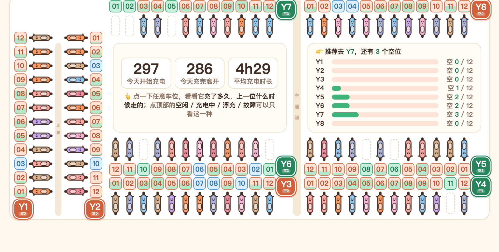
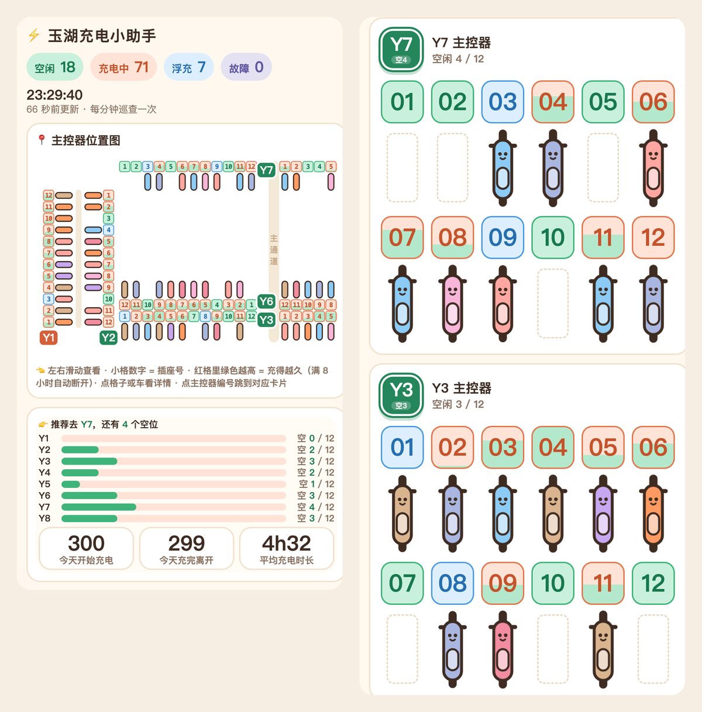
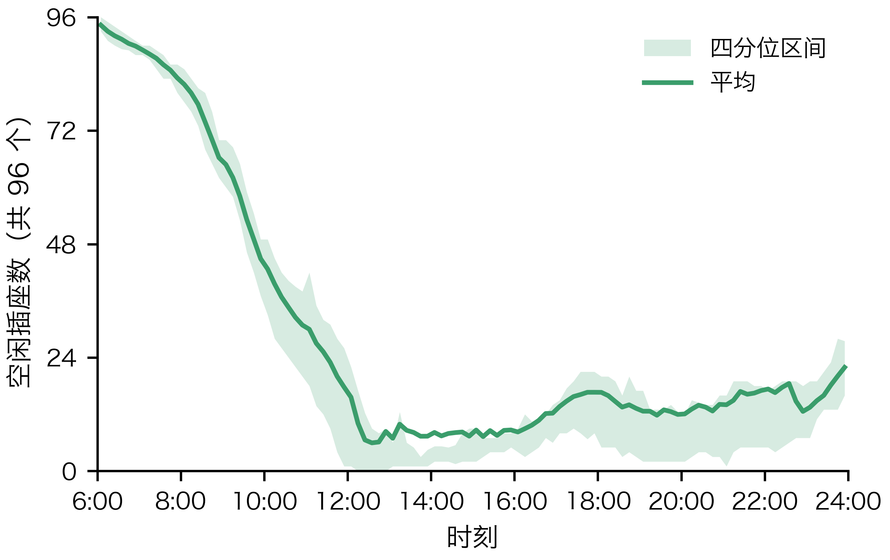
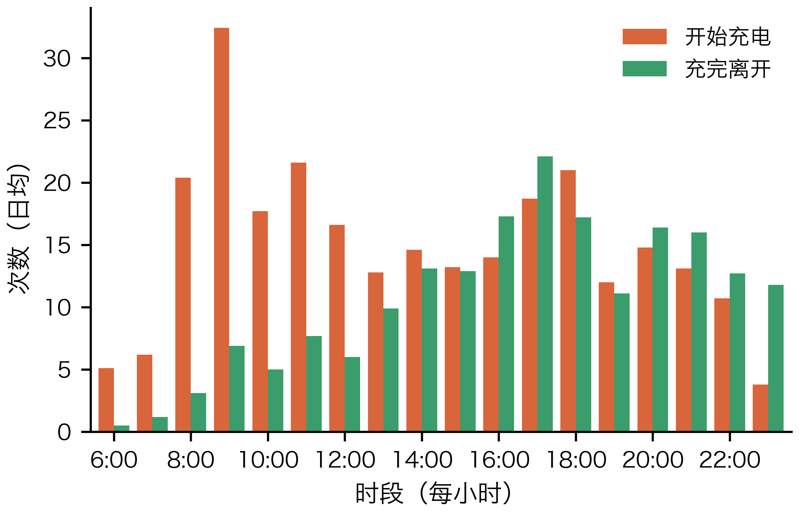
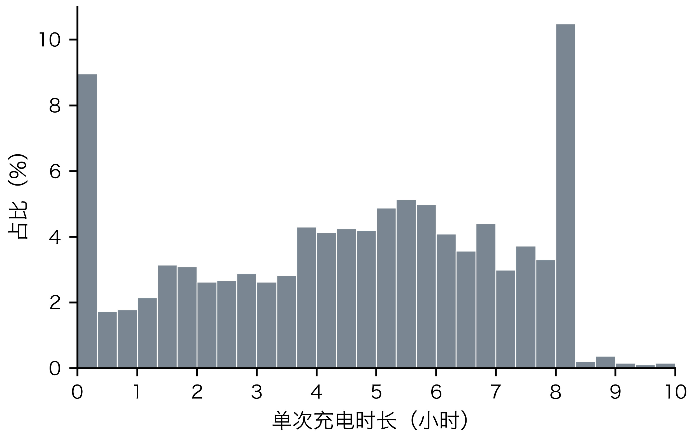
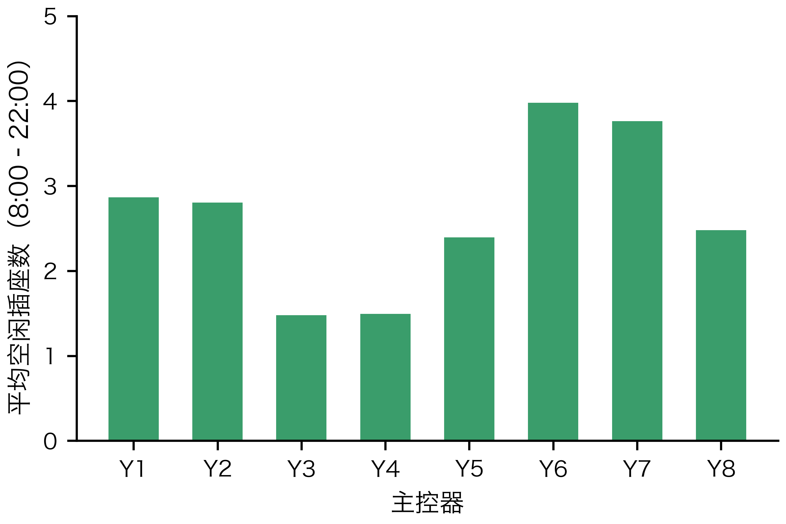
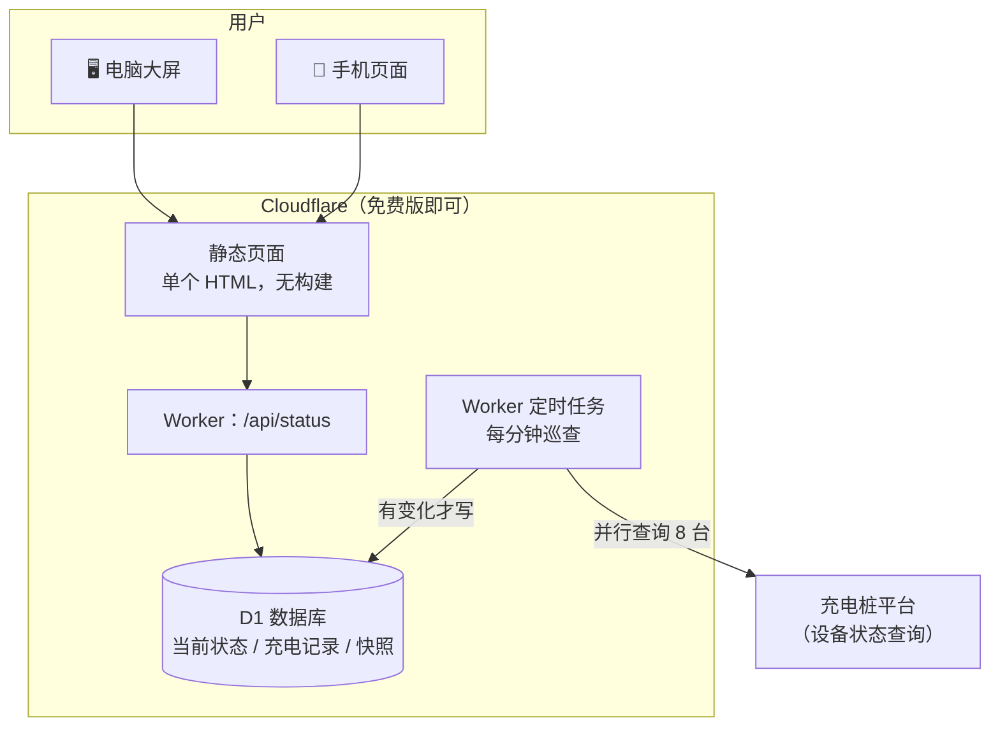

<div align="center">

# ⚡ 玉湖充电小助手

**浙大紫金港 · 玉湖车棚电动车充电桩实时监控**

看得到**真实车位布局**，精确到**每一个充电口**的空闲情况

[](https://charge.shizaishiwo.com)
[](https://v.douyin.com/MpWuQrM283E/)
[](https://www.bilibili.com/video/BV1kQsi66EDQ/)
[](LICENSE)




</div>

---

> 😩 中午去玉湖充电，绕了三圈，一个空位都没有。连着三天都是这样。
>
> 🔌 于是第二天起了个大早，先把电充上，顺手把玉湖 8 台主控器上的二维码全拍了下来，回去做了这个小工具。

**玉湖充电小助手**每分钟查一次玉湖车棚 8 台充电主控器（Y1–Y8）共 **96 个插座**的状态，按现场的真实布局画出来：
哪一排、第几号口空着，走过去之前就能知道。

- 🌐 **在线使用**：<https://charge.shizaishiwo.com>（电脑是大屏，手机自动切换为卡片 + 位置小地图）
- 🎬 **开发故事**：[抖音视频](https://v.douyin.com/MpWuQrM283E/) · [B站视频](https://www.bilibili.com/video/BV1kQsi66EDQ/)

> [!NOTE]
> 本项目仅供学习交流，不用于任何商业用途。数据来自充电桩平台公开展示给扫码用户的插座状态，
> 只做低频（每分钟一次）只读查询。**本仓库只公开思路和方法，不公开具体接口**，请大家复刻时同样克制、友善地使用。

## 🙏 致敬前人工作

做完以后才在抖音评论区里得知，浙大已经有同学做了非常完善的充电桩查询工具
**[ZJU-Charger](https://github.com/ZJU-Charger/ZJU-Charger)**（覆盖多个校区、多个充电品牌，还支持 iOS 快捷指令和钉钉机器人）。
本仓库的 README 结构也参考了它，在此致谢 🙇

玉湖充电小助手只是针对**紫金港玉湖车棚一个点位**做得更细一些，算是一个小小的补充：

| | ZJU-Charger | 玉湖充电小助手 |
|---|---|---|
| 覆盖范围 | 多校区、多品牌，范围广 | 只有玉湖车棚（8 台主控器 / 96 个口） |
| 展示粒度 | 以充电站为单位的空闲数量 | **每一个插座**的状态，按**现场真实排布**画出来 |
| 额外信息 | 定位排序、关注列表、快捷指令 | 每个口已充多久、预计何时空出、上一位什么时候走的 |

如果你常去别的车棚，强烈推荐直接用 ZJU-Charger。

## ✨ 功能

<div align="center">

<br>手机端：左边是位置小地图 + 推荐，右边是每台主控器的卡片
</div>

- 🗺️ **真实布局**：按手绘的现场草图还原 8 台主控器的位置、每排插座的方向和车头朝向，找口子不用再一排排看
- 🔌 **精确到每个口**：空闲 / 充电中 / 浮充 / 故障四种状态，一目了然
- 🟩 **充电进度条**：充电中的格子从下往上“灌绿色”，高度 = 已充时间 ÷ 8 小时（平台单次上限），越绿 = 越快空出来
- 👉 **推荐去哪台**：自动推荐空位最多的主控器
- 🔍 **一键筛选**：点顶部“空闲 / 充电中 / 故障”，只高亮这一类插座，并按主控器列出编号
- 📋 **复制设备编号 + 去充电**：点开车位详情可以直接跳到该主控器的扫码充电页
- 📈 **今日统计**：今天开始了多少次充电、充完离开多少次、平均充电时长
- 🌙 **适配夜间断电**：玉湖 0:00–6:00 统一断电，夜里会自动降频巡查并给出提示

## 📊 数据里的几个发现

2026-11-11 至 11-20 约十天的数据（每分钟快照 + 2600 多次充电记录），样本还不多，仅供参考。

**1. 中午最难找到空位**：8 点以后空位迅速减少，12–15 点 96 个插座平均只剩 8 个左右；12 点那一小时里约三成的时间一个空位都没有。

<div align="center"></div>

**2. 早上来得多、走得少**：9 点那一小时平均 30 多辆车开始充电，充完离开的只有 7 辆左右；离开高峰在 17 点前后。

<div align="center"></div>

**3. 一充就是好几个小时**：单次充电时长中位数接近 5 小时，8 小时处的尖峰对应平台单次 480 分钟的上限（不含 0 点断电截断的记录）。

<div align="center"></div>

**4. 主控器之间差别明显**：白天 Y6、Y7 平均约 4 个空位，Y3、Y4 只有 1.5 个左右。

<div align="center"></div>

## 🧭 复刻思路（方法概述）

完整步骤见 **[docs/复刻指南.md](docs/复刻指南.md)**，这里是一页纸版本：


1. **拿到设备编号**：每台主控器上都贴着扫码充电的二维码，二维码里的链接末尾就是设备编号（玉湖的见下表）。
2. **找到状态接口**：用电脑版微信打开二维码链接，同时开着 mitmproxy 之类的抓包工具，看“选择插座”页面加载时发了哪些请求，
   其中一个会返回一串表示每个插座状态的字符；再对照页面上显示的颜色，就能弄清每个状态码的含义。
3. **定时巡查**：Cloudflare Worker 的定时任务（Cron）每分钟并行查一遍 8 台主控器，状态没变化就不写库，省免费额度。
4. **从快照到“充电记录”**：拿这一次和上一次的状态逐口比较，空闲 → 占用记为开始，占用 → 空闲记为结束；
   因为每分钟才看一次，开始/结束时间都记成一个区间，统计时长时取中点。
5. **画布局**：把现场手绘草图转写成一个布局配置（哪台主控器在哪、每排口子从左到右还是从右到左、车头朝哪），前端按配置渲染。

## 📷 玉湖主控器二维码链接

这些是贴在玉湖各台主控器上的**扫码充电二维码**里的链接（现场拍照所得，在微信里打开即可扫码充电，任何人到现场都能看到）：

| 主控器 | 扫码充电链接 | 主控器 | 扫码充电链接 |
|---|---|---|---|
| Y1（无编号贴纸那台） | `http://szlzxn.cn/wechat/wxscan/50959130` | Y5 | `http://szlzxn.cn/wechat/wxscan/50959126` |
| Y2 | `http://szlzxn.cn/wechat/wxscan/50959123` | Y6 | `http://szlzxn.cn/wechat/wxscan/50959127` |
| Y3 | `http://szlzxn.cn/wechat/wxscan/50959124` | Y7 | `http://szlzxn.cn/wechat/wxscan/50959128` |
| Y4 | `http://szlzxn.cn/wechat/wxscan/50959125` | Y8 | `http://szlzxn.cn/wechat/wxscan/50959129` |

现场布局（大屏就是按这张草图画的）：

```
        Y7 排：1→12 ▲ [Y7] ║ Y8 排：1→12 ▲ [Y8]
Y1列 走 Y2列              ║
12↓1 廊 1↓12              ║
 ◀       ▶                ║
        Y6 排：12←1 ▼ [Y6] ║ Y5 排：12←1 ▼ [Y5]
        Y3 排：1→12 ▲ [Y3] ║ Y4 排：1→12 ▲ [Y4]
[Y1]   [Y2]             主通道
```

三角形 = 车头朝向。Y6/Y3、Y5/Y4 背靠背共用一条充电线。

## 🏗️ 系统架构



设计上的几个小原则：

- **页面不直接查平台**：所有人看的都是数据库里的最新结果，访问人数再多，对平台的请求量也不变（每分钟 8 次）。
- **租约防重复**：定时任务和“页面发现数据过期时顺手巡查”用同一把租约，不会重复查询。
- **只写变化**：状态没变就不写库；夜里车位全空且 30 分钟无变化时降为每 30 分钟确认一次。

## 📂 仓库结构

```
yuhu-charger/
├── README.md
├── docs/
│   ├── 复刻指南.md        # 从拍二维码到上线的完整方法
│   └── 数据与统计.md      # 状态归类、充电记录的区间表示、夜间断电的处理
├── template/
│   ├── schema.sql         # 数据库表结构（可直接用）
│   ├── worker.example.js  # Worker 骨架：巡查 + 对比 + API（接口地址留空，需自行填写）
│   └── wrangler.example.jsonc
├── assets/                # 截图
└── LICENSE
```

## 🗺️ 后续计划

- [x] 分时段空位、到达 / 离开、充电时长、各主控器空位的初步统计（见上文“数据里的几个发现”）
- [ ] 数据再多攒几周后，把工作日和周末分开统计
- [ ] “到达成功率”预测：告诉它“我 10 分钟后到”，估计到时候某台主控器至少有一个空位的概率
- [ ] 合并 1–2 分钟内断开又接上的抖动记录

## 🤝 欢迎指点

这是一个课余随手做的小工具，代码和想法都还很粗糙，肯定有很多考虑不周的地方。
发现问题、有建议，或者想在自己常去的车棚复刻一份，都欢迎提 [Issue](https://github.com/shizaishiwo323/yuhu-charger/issues) 交流 🙏

## 致谢

- [ZJU-Charger](https://github.com/ZJU-Charger/ZJU-Charger)：浙大充电桩查询的前辈项目
- [Cloudflare Workers / D1](https://developers.cloudflare.com/workers/)：免费的运行环境和数据库
- [mitmproxy](https://mitmproxy.org/)：抓包分析
- 抖音评论区里给出建议的同学们

## License

[MIT](LICENSE)
